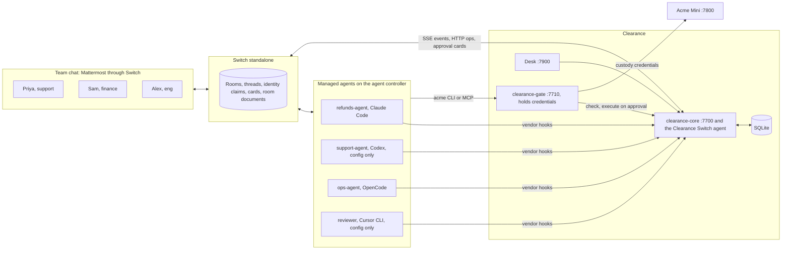
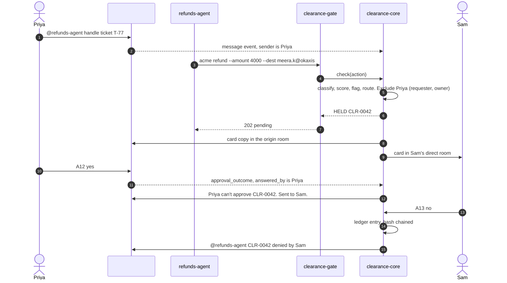

# Architecture

Clearance is three processes beside a Switch deployment, plus a fake company to act on.

## A refund, step by step

That's the refund our real runs produced: the agent caught the ticket's ₹40,000 and offered the correct ₹4,000 to a payment ID added minutes earlier. The new ID is what the card flags.

On approval the gate executes the stored call with its own credentials and core posts the refund id to the thread. The agent never retries a business action.

For a local action caught by a hook, a hold is a deny with a reason. On approval core mints a grant bound to the call's hash, single use, valid for 10 minutes, and tells the agent to run the same command once. Any change to the arguments creates a new request.

## Decisions that shape the code

No LLM runs in the decision path. Classify, score, route, grant, escalate, drill and promote are deterministic code over `policy/clearance.policy.yaml`.

Everything fails closed. A missing fact, an unknown agent directory, a dead core and an expired request all end in hold or deny.

Our request lifetime is 25 minutes, under the 30-minute interrupt in Switch's docs, so Clearance always decides first.

Core and the Switch client are one process, to keep the moving parts few for someone cloning the repo. The gate is separate because it holds credentials.

Agents run inside a bubblewrap fence, one per machine, so they can't read the repo, `data/`, the real home or other processes. [The threat model](threat-model.md) has what that does and doesn't stop.

Core's 1 s tick retries what didn't finish: a card Switch didn't take, an execute the gate didn't answer, a review that never opened. Each of those also has a path that does it straight away, so each one guards against the tick arriving while that path is still working.

## Package map

| Package | Purpose |
|---|---|
| `packages/contracts` | Shared zod schemas and the ports core depends on |
| `packages/core` | Policy, classify, risk, router, requests, grants, escalation, drills, rubber-stamp, autonomy, ledger, cards, API |
| `packages/switch-agent` | Switch protocol client and the `ChatPort` implementation |
| `packages/adapters` | Vendor payload to `Action`, vendor response builders, hook routes |
| `packages/gate` | HTTP proxy and MCP server, custody credentials, execute on approval |
| `packages/hook-cli` | `clearance-hook` for vendors without HTTP hooks |
| `packages/acme` | The fake company, with synthetic data |
| `packages/desk` | Read-mostly dashboard |
| `acme-mini-app/` | The agents' working directory, carrying each vendor's enforcement config |

`docs/integration-contract.md` has the HTTP shapes between them.
